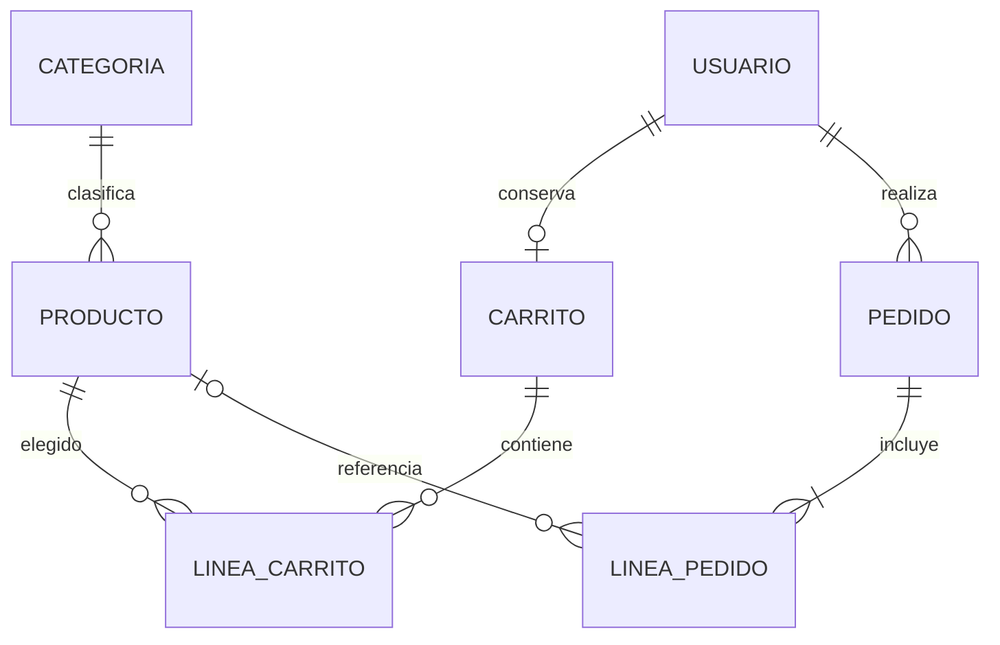

# API REST y base de datos

Backend en capas con Java 17, Spring Boot 3, Spring Data JPA, Hibernate, Maven y MySQL. Mantiene la API de artículos de la consigna inicial y agrega los endpoints de catálogo y tienda consumidos por [`../front`](../front/README.md).

## Requisitos

- JDK 17.
- MySQL Server.
- Maven 3.8.6 o superior, o Eclipse con integración Maven (m2e).
- Postman para importar la colección de `postman/`.

## Instalar o actualizar la base

En MySQL Workbench, abrí y ejecutá el archivo completo [`database/migrate_ecommerce.sql`](database/migrate_ecommerce.sql). Es el único SQL necesario, tanto para una base nueva como para actualizar una existente. Crea `articulos_db`, instala las tablas, agrega una categoría `General` y el usuario de demostración `demo@mercado.local`, y copia los registros de `articulo` a `producto` con stock inicial cero. Se puede volver a ejecutar sin borrar los datos.

La configuración local predeterminada apunta a `localhost:3306`, base `articulos_db`, usuario `root` y contraseña `admin`. Para usar otros valores, configurá `DB_URL`, `DB_USERNAME` y `DB_PASSWORD` como variables de entorno. `root/admin` es solo la conexión a MySQL; no es una cuenta de la aplicación.

## Modelo de datos

Las tablas están separadas para que el inventario, el carrito pendiente y la compra ya registrada tengan reglas y tiempos de vida distintos.

| Tabla | Datos guardados | Motivo y comportamiento |
| --- | --- | --- |
| `articulo` | ID, nombre y precio. | Entidad del ejercicio original. Se mantiene para que `/api/articulos` siga cumpliendo la consigna y sus pruebas. |
| `categoria` | ID y nombre único. | Organiza el catálogo y evita guardar/repetir el nombre de categoría en cada producto. |
| `producto` | Nombre, descripción, `imagen_url` opcional, precio, stock, categoría y `activo`. | Catálogo real de la tienda. El stock disponible se valida al crear y confirmar pedidos. Al quitar un producto se archiva (`activo=false`) para proteger el historial. |
| `usuario` | Nombre y correo único. | Identidad de demostración de la persona que opera la tienda; conecta su carrito e historial. No almacena contraseña. |
| `carrito` | ID y usuario. | Hay como máximo un carrito por usuario; permanece guardado en MySQL entre sesiones del navegador. |
| `linea_carrito` | Carrito, producto y cantidad. | Guarda qué productos y cantidades eligió la persona. El precio no se congela acá: se toma del catálogo al mostrar y al crear el pedido. |
| `pedido` | Usuario, fecha de creación, estado y total. | Registra una compra y su evolución (`PENDIENTE`, `CONFIRMADO`, `ENVIADO`, `ENTREGADO` o `CANCELADO`). |
| `linea_pedido` | Pedido, producto opcional, nombre, cantidad, precio unitario y subtotal. | Guarda una fotografía de los artículos y precios al comprar, para que el historial no cambie cuando se edite o elimine el producto. |

Relaciones principales:

`articulo` y `producto` son tablas distintas: el SQL conserva los datos del ejercicio original y los copia al catálogo de tienda. Como `articulo` no tiene categoría ni stock, los registros copiados usan `General` y stock `0`; cargá las existencias reales desde el front antes de confirmar pedidos.

El pedido creado desde el carrito y el vaciado de ese carrito ocurren en una transacción: si no se guarda el pedido (por ejemplo, por stock insuficiente), el carrito permanece. Los pedidos se crean pendientes; el stock se descuenta al confirmarlos y se reintegra si un pedido confirmado se cancela.

El login solo identifica por correo para la demostración; no es autenticación segura y no protege los endpoints. En el front podés usar `demo@mercado.local` o crear otro usuario.

## Ejecutar

### Desde Eclipse

1. Abrí la carpeta `api` como proyecto. Si Eclipse no lo reconoce, usá **Configure → Convert to Maven Project**; si ya es Maven, **Maven → Update Project…**.
2. Esperá que Maven descargue dependencias y seleccioná JDK 17 en **Project → Properties → Java Build Path → Libraries**.
3. Verificá que MySQL esté iniciado y que ya hayas ejecutado el SQL de arriba.
4. Clic derecho en `ArticuloApiApplication.java` → **Run As → Java Application**.

La API queda en `http://localhost:8081`. Desde la raíz del repositorio, también podés usar `cd api` y `mvn spring-boot:run`; para generar el JAR: `mvn clean package` y luego `java -jar target/articulo-api-mysql-0.0.1-SNAPSHOT.jar`.

## Endpoints de artículos originales

| Método | Ruta | Resultado |
| --- | --- | --- |
| GET | `/api/articulos` | Lista artículos. |
| GET | `/api/articulos/{id}` | Consulta uno (`404` si no existe). |
| POST | `/api/articulos` | Crea `{ "nombre": "Teclado", "precio": 15000 }`. |
| PUT | `/api/articulos/{id}` | Actualiza un artículo. |
| DELETE | `/api/articulos/{id}` | Elimina y responde `204`. |

Nombre requerido y precio mayor que cero. Se conserva este contrato para la consigna y la colección de pruebas original.

## Endpoints adicionales de tienda

| Método | Ruta | Uso |
| --- | --- | --- |
| GET | `/api/productos?incluirInactivos=true` | Lista el catálogo; opcionalmente incluye archivados. |
| GET | `/api/productos/{id}` | Consulta producto. |
| GET | `/api/productos/stock-bajo?umbral=5` | Consulta productos con stock bajo. |
| POST / PUT | `/api/productos` / `/api/productos/{id}` | Crea o actualiza; acepta `imagenUrl` HTTP/HTTPS opcional. |
| DELETE / PATCH | `/api/productos/{id}` / `/api/productos/{id}/reactivar` | Archiva o reactiva. |
| GET / POST | `/api/categorias` | Lista o crea categorías. |
| PUT / DELETE | `/api/categorias/{id}` | Actualiza o elimina una categoría sin productos asociados. |
| GET / POST | `/api/usuarios` | Lista o crea usuarios de demostración. |
| PUT / DELETE | `/api/usuarios/{id}` | Actualiza o elimina si no tiene pedidos. |
| POST | `/api/auth/login` | Identifica al usuario por correo. |
| GET / DELETE | `/api/carritos/{usuarioId}` | Consulta o vacía el carrito. |
| POST | `/api/carritos/{usuarioId}/items` | Agrega producto y cantidad (suma si ya existe). |
| PUT / DELETE | `/api/carritos/{usuarioId}/items/{productoId}` | Cambia cantidad o quita el producto. |
| GET | `/api/pedidos?usuarioId={id}` | Consulta pedidos o historial de un usuario. |
| GET | `/api/pedidos/{id}` | Consulta un pedido. |
| POST | `/api/pedidos` | Crea pedido pendiente desde un JSON de líneas. |
| POST | `/api/pedidos/desde-carrito` | Valida stock, crea pedido y vacía el carrito atómicamente. |
| PUT | `/api/pedidos/{id}/estado` | Cambia el estado según las transiciones permitidas. |

## Postman

Importá [`postman/Articulo API MySQL.postman_collection.json`](postman/Articulo%20API%20MySQL.postman_collection.json). La colección usa `http://localhost:8081` como `baseUrl`; las solicitudes originales de artículos se ejecutan en orden para reutilizar los IDs.

## Código anterior

El proyecto de consola de preentrega se conserva en `preentrega-console/` separado de `src/main/java`; no forma parte del source root de Maven.

## Grabación de la defensa

La consigna pide agregar un enlace a la grabación de la demostración. Cuando el video esté grabado y publicado, colocá aquí su URL; todavía no se incluyó ningún enlace.
